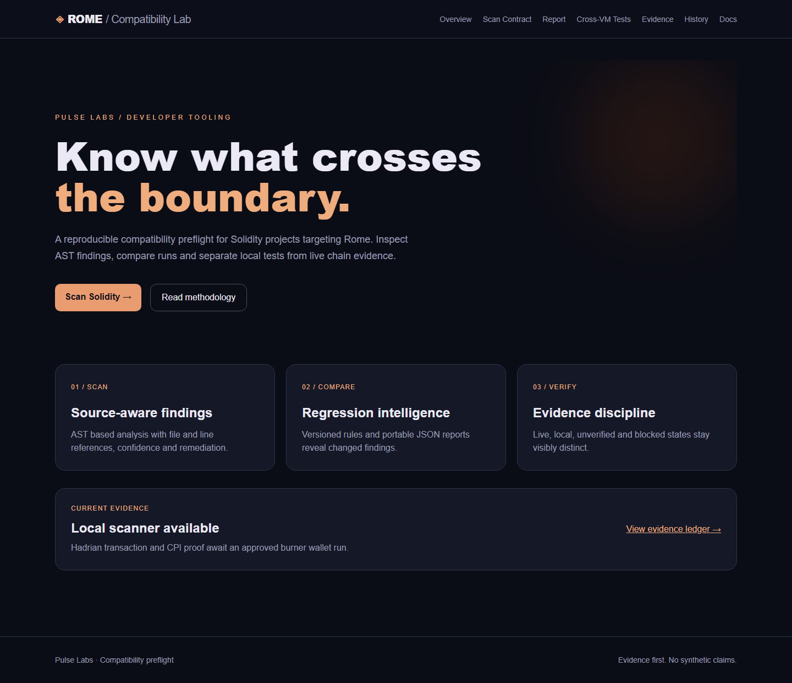
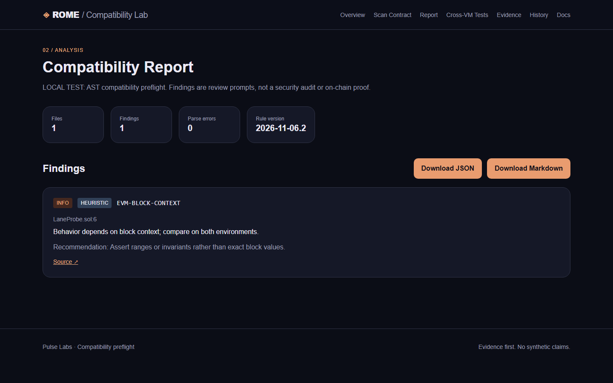

# Rome Compatibility Lab — v2 release candidate

This is the local v2 release candidate. It includes four historical local EVM executions, four verified Hadrian transactions, and a mapped finalized Solana Memo CPI. The completed MetaMask page has no send controls. Production Vercel still serves the earlier approved release until the owner authorizes publication. See [live evidence](evidence/hadrian-live.json), [release notes](docs/RELEASE_NOTES_V2.md), and [test evidence](docs/TEST_EVIDENCE_V2.md).

Quick local demonstration:

```sh
npm ci
npm test
npm run evm:local
npm run probe:prepare
npm run cpi:prepare
npm run network:check
npm run dev
```

The browser scanner accepts up to 40 `.sol` files or a project folder. It checks relative imports against selected files but does not compile arbitrary browser uploads or resolve external packages. CLI and fixed probes provide the reproducible preparation path. A preceding `// rome-lab-ignore RULE: reason` comment suppresses a finding on the next line while preserving it visibly in the report. The local review route `/source/{Probe}.sol` serves the exact checked-in probe source used by the evidence ledger.

Recheck the public Hadrian and Solana evidence with `npm run evidence:verify`. This read-only command writes `evidence/hadrian-live.json`; it does not sign or send transactions. The older preparation and deployment scripts remain for historical reproducibility and are not part of the completed UI workflow.

## Previous v1 release information

Rome Compatibility Lab is a Solidity AST preflight for teams evaluating contracts for [Rome](https://docs.rome.builders/). It points to source files and lines, explains Rome-specific review points, and compares portable reports. It does **not** compile untrusted submissions, prove cross-VM execution, or perform a security audit.

## Historical v1 review evidence

The browser scanner, CLI, GitHub importer guards, and report comparison have local automated tests. On 6 November 2026, typecheck, strict TypeScript lint, all 20 unit/security tests, all four E2E tests against the production build, the production build, and both npm audits passed locally. Local HTTP checks returned 200 for `/`, `/scan`, `/report`, `/history`, and `/evidence`, and 503 for anonymous `POST /api/scan`. The owner confirmed Hadrian RPC HTTP 200 with chain ID 200010 and explorer HTTP 200. The checked-in Hadrian probe has only been compiled locally; no contract has been deployed and no on-chain proof is claimed. The pinned Rome registry is `v0.1.0`, while the upstream README recommends `v0.3.0`; reconcile that version before any live deployment.




## Run locally

Use Node.js 22 and npm. On Windows PowerShell use `npm.cmd` in place of `npm`.

```sh
npm ci
npm run dev
```

Open `http://localhost:3000`. Paste Solidity or upload a `.sol` file (100 KB max). Scanning pasted and uploaded code runs in your browser, so the public demo works with the hosted API disabled. Reports show severity, confidence, file, line, explanation, recommendation, and source. Download JSON or Markdown, or compare two JSON reports locally in History. The CLI handles up to 40 files and 1 MiB total.

```sh
npm run cli -- scan probes --out report.json
npm run cli -- scan examples --markdown
npm run cli -- compare old.json new.json
npm run probe:prepare
```

CLI exit codes: `0` for a scan without confirmed high findings, `1` for a confirmed high finding, `2` for invalid input or parse errors. The `examples/` directory intentionally exits `1`; see [expected results](examples/README.md). A clean scan is not proof of compatibility.

## Hosted GitHub import and API protection

`POST /api/scan` is disabled by default and returns 503. It can be enabled only after configuring a shared Upstash Redis quota and a Vercel WAF rule. The application uses an atomic Redis script for a **global 120 requests/hour** quota and **8 concurrent requests** across serverless instances, plus a local two-request cap. If Redis is unavailable or misconfigured, the endpoint fails closed. No in-memory counter is presented as a distributed limit.

Set `UPSTASH_REDIS_REST_URL` and `UPSTASH_REDIS_REST_TOKEN` as **server-side** Vercel environment variables. Then publish a WAF rule for `POST /api/scan`: per-IP fixed window, 10 requests per 10 minutes, action 429. Finally set `ROME_SCAN_API_ENABLED=1` and build-time `NEXT_PUBLIC_SCAN_API_ENABLED=1`. See [release checklist](ROME_RELEASE_CHECKLIST_RU.md) for exact steps, costs and verification. The Upstash free database has a finite monthly command quota; the route's global cap is below it at maximum sustained usage. Do not put the standard token in the browser or repository.

The endpoint accepts exactly one of `files` or a public `github.com/owner/repo` URL. It requires JSON, limits request and source sizes, rejects unsafe paths and malformed UTF-8, and returns generic errors without secrets. GitHub import is restricted to fixed `api.github.com` URLs, refuses redirects, and has bounded response sizes and timeouts. The server uses a 30-second function duration cap. Browser local scanning does not consume server scan resources.

## Verify changes

```sh
npm ci
npm audit
npm audit --omit=dev
npm run typecheck
npm run lint
npm test
npm run cli -- scan probes --out report.json
npm run cli -- compare report.json report.json
npm run build
npx playwright install chromium
npm run test:e2e
```

`npm test` includes scanner, GitHub importer, API quota, malformed input and output-escaping regressions. `npm run lint` is a strict TypeScript unused-code check, not ESLint. The E2E suite covers the local scan flow, upload, Markdown export, API fail-closed behavior and evidence status. On Windows, if Playwright's managed dev-server cleanup hangs, start the built server separately with `npm run start` and run E2E against it.

## Historical Hadrian preparation notes

Read-only checks: `npm run network:check` or, on ordinary Windows PowerShell, `powershell -File scripts/diagnose-hadrian.ps1`. Both use the pinned registry. The latter writes `hadrian-diagnostic.json` (ignored by Git). The pinned values are chain ID 200010, RPC `https://hadrian.testnet.romeprotocol.xyz/`, and explorer `https://via-hadrian.testnet.romeprotocol.xyz/`. The owner confirmed RPC and explorer reachability on 6 November 2026; this release session did not independently repeat those probes. The current official registry version must be reviewed before deployment.

`npm run probe:prepare` compiles only the checked-in `probes/LaneProbe.sol` with an integrity-checked Solidity 0.8.24 compiler and writes unsigned `probe-preparation.json`. `npm run hadrian:dry-run` reads estimates only. These notes describe the earlier preflight; the current verified receipts, addresses and Solana settlement are in `evidence/hadrian-live.json`.

Use [Rome's current CPI interface](https://docs.rome.builders/developer-guides/call-solana-from-evm) and [canonical registry](https://github.com/rome-protocol/rome-registry) for addresses and ABI. The scanner's rules are narrow AST checks; indirect data flow, imports and bytecode behavior need review and actual tests. Read the [constraints](https://docs.rome.builders/core-concepts/constraints) before attempting CPI.

## Release and licensing

Source is [MIT licensed](LICENSE). The pinned `soljson.js` is from the official `solc@0.8.24` npm archive, with its original MIT license in `vendor/solc-0.8.24/LICENSE`; provenance and other dependency licenses are recorded in [third-party notices](THIRD_PARTY_NOTICES.md). `node_modules`, local reports, backups, credentials and diagnostic output are ignored. The public source repository is [chapaevv123/rome-compatibility-lab](https://github.com/chapaevv123/rome-compatibility-lab). Its initial commit `d6861fbad9cb10b3cf793c0941a4ddc6ff8970e9` passed [GitHub Actions CI](https://github.com/chapaevv123/rome-compatibility-lab/actions/runs/42242433457), including both audits, build, unit tests, E2E, and CLI checks. The public read-only demo is [rome-compatibility-lab.vercel.app](https://rome-compatibility-lab.vercel.app). The Git-sourced Vercel deployment for commit `5238c846ce415171790e10727454b2b8509408aa` was verified over HTTPS: main pages returned 200, browser scan, JSON/Markdown export and report comparison passed, and anonymous `POST /api/scan` returned 503. Its [GitHub Actions run](https://github.com/chapaevv123/rome-compatibility-lab/actions/runs/42248275576) succeeded. Rome Arena registration remains a manual owner action.

See the [public security policy](SECURITY.md), [release checklist](ROME_RELEASE_CHECKLIST_RU.md), and [Arena draft](ROME_ARENA_SUBMISSION.md). Detailed local audit logs and owner reports are kept outside the public repository.
